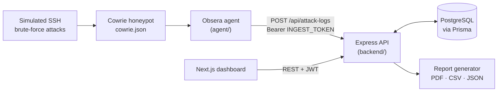

<p align="center">
  <picture>
    <source media="(prefers-color-scheme: dark)" srcset="public/brand/obsera-mark-on-dark.svg">
    
  </picture>
</p>

<h1 align="center">Obsera</h1>

<p align="center">
  SSH honeypot monitoring dashboard. Final-year project, tested with simulated attacks.<br>
  <sub>Proyek tugas akhir. Dokumentasi berbahasa Inggris.</sub>
</p>

<!-- TODO: links line, e.g. **[Demo](https://…)** · **[Case study](https://…)** · **[Video](https://…)** -->

<p align="center">
  
  
</p>

<!-- TODO: preview GIF or screenshot of the dashboard (light + dark via <picture>), e.g. docs/screenshots/dashboard-light.png and dashboard-dark.png -->

## About

An SSH honeypot such as [Cowrie](https://github.com/cowrie/cowrie) records every login attempt it receives, but as a JSON log file. Obsera turns that log into something an analyst can work with: who is attacking, how hard, with which credentials, and whether anyone has looked at it yet. A small agent on the honeypot host forwards failed logins to an Express API, and a Next.js dashboard shows them as metrics, timelines, per-source detail pages and downloadable reports.

Obsera was built as a final-year project. All data in it comes from simulated SSH brute-force attacks run against the honeypot, not from traffic on the public internet.

## Features

- **Overview metrics** for total attempts, unique sources, and the most tried password and username, compared with the previous period of the same length.
- **Global time range** (1h, 24h, 7d, 30d or a custom window) shared by the dashboard and reports.
- **Attack timeline and heatmap**: zero-filled bar chart per minute, hour or day, and a day-of-week × hour-of-day grid.
- **Attack logs per source IP** with search, filters, sorting and bulk review status, plus a detail page per IP with every attempt and CSV/JSON export.
- **Credential analysis**: top passwords, top usernames and unique username:password pairs.
- **Rule-based risk levels** for each source (by attempt volume) and each attempt (by the credentials tried).
- **Reports** for a chosen period, downloadable as PDF (vector charts and a methodology appendix), CSV or JSON.
- **Administration**: user management, session timeout, timezone, audit log, password change, sensor heartbeat status, and light/dark themes.

## Architecture



The agent follows Cowrie's JSON log and sends each `cowrie.login.failed` event to the API, authenticated with a shared ingest token. It also sends a heartbeat every minute so the dashboard can tell a quiet sensor from a dead one. The API stores attempts per attacking source in PostgreSQL and serves aggregated views (stats, timeline, heatmap, top sources) to the dashboard, which signs in with a JWT. The dashboard refreshes by polling every 30 seconds. Reports are rendered on the server with pdfmake and stored once per report, so later downloads return the same file.

## Tech stack

| Layer | Technology |
|---|---|
| Frontend | Next.js 16.1 (App Router), React 19.2, TypeScript 5 |
| UI | Tailwind CSS 4, shadcn/ui (Radix), lucide-react, Recharts 2.15, next-themes |
| Backend | Node.js, Express 5.2, Zod 4, Helmet, express-rate-limit |
| Data | PostgreSQL, Prisma 7.8 (`@prisma/adapter-pg`) |
| Auth | JWT (jsonwebtoken), bcryptjs |
| Reports | pdfmake 0.2, IBM Plex fonts (OFL) |
| Sensor | Cowrie + Node.js agent (`tail`, `dotenv`) |
| Tests | `node:test` (backend) |

## Design decisions

- **One risk module for every surface.** [`shared/risk-rules.js`](shared/risk-rules.js) defines the thresholds once (more than 100 attempts is Medium, more than 500 is High). The dashboard, the API filters and the PDF report all load it, and the report's methodology appendix prints its definitions from the same file.
- **Bars for time series, not lines.** Attempts arrive in bursts. A line interpolates between buckets and turns one spike into a slope, so the timeline uses zero-filled bars and empty buckets draw nothing.
- **Orange is a signal, never the brand.** The palette is derived from the logo's blue. Orange is reserved for warnings, "new" markers and rising metrics, with a darker text variant that keeps 5:1 contrast on white.
- **No invented locations.** Private and loopback addresses are labelled as such instead of being geolocated. Country and ASN fields stay empty until a real GeoIP source is connected.
- **Separate credentials for the sensor and for people.** The agent uses a shared ingest token. Dashboard users sign in with a JWT, and changing a password signs out the account's other sessions.

<!-- TODO: link to the full case study -->

## Running locally

### Prerequisites

- Node.js 20.19 or newer (required by Prisma 7; Next.js 16 needs 20.9+)
- PostgreSQL with an empty database, e.g. `honeypot_db`
- Optional: a Cowrie honeypot for live data (see [`agent/README.md`](agent/README.md))

### Steps

1. Clone the repository and install both packages.

   ```bash
   git clone https://github.com/<owner>/obsera.git  # TODO: final repository URL
   cd obsera
   npm install
   npm install --prefix backend
   ```

2. Create the environment files and fill them in (see the tables below).

   ```bash
   cp .env.example .env.local
   cp backend/.env.example backend/.env
   openssl rand -hex 32   # run twice: one value for JWT_SECRET, one for INGEST_TOKEN
   ```

3. Create the database schema and seed an admin account. Without `SEED_ADMIN_PASSWORD` the seed generates a random password and prints it once.

   ```bash
   cd backend
   npx prisma migrate deploy
   npm run prisma:generate
   npm run prisma:seed
   cd ..
   ```

4. Start the frontend and backend together.

   ```bash
   npm run dev
   ```

   Open <http://localhost:3000>. The API listens on <http://localhost:4000> (`/api/health` returns its status).

To change an admin password from the terminal, run `npm run reset-password -- <email>` in `backend/`. Backend tests run with `npm test` in `backend/`.

### Environment variables

Frontend (`.env.local`):

| Variable | Required | Description |
|---|---|---|
| `NEXT_PUBLIC_API_URL` | yes | Backend URL called from the browser. Inlined at build time. |
| `BACKEND_URL` | no | Backend URL for server-side code. Defaults to `NEXT_PUBLIC_API_URL`. |

Backend (`backend/.env`):

| Variable | Required | Description |
|---|---|---|
| `DATABASE_URL` | yes | PostgreSQL connection string. |
| `JWT_SECRET` | yes | Signs dashboard session tokens. |
| `INGEST_TOKEN` | yes, for the agent | Shared secret the agent sends. Without it, ingest and heartbeat requests are rejected. |
| `FRONTEND_URL` | no | Origin allowed by CORS. Default `http://localhost:3000`. |
| `PORT` | no | API port. Default `4000`. |
| `NODE_ENV` | no | `development` or `production`. |
| `SEED_ADMIN_EMAIL` | no | Admin created by the seed. Default `admin@obsera.local`. |
| `SEED_ADMIN_PASSWORD` | no | Password for that admin. Empty means a random one is generated. |

The agent's variables (`OBSERA_API_URL`, `OBSERA_INGEST_TOKEN`, `COWRIE_LOG_PATH`, …) are documented in [`agent/README.md`](agent/README.md).

## Deployment

There is no deployment guide or demo mode yet. For a split deployment (dashboard on Vercel, API and database elsewhere), set `NEXT_PUBLIC_API_URL` before the frontend build, and set `FRONTEND_URL` on the backend to the dashboard's origin so CORS accepts it.

<!-- TODO: link docs/DEPLOY.md and describe demo mode once they exist -->

## Project structure

```text
.
├── app/            Next.js App Router: login, dashboard, attack logs, reports, settings
├── components/     Dashboard widgets, layout (header, sidebar) and shadcn/ui primitives
├── lib/            Frontend helpers: API client, time ranges, formatting, live updates
├── shared/         Plain JS used by frontend and backend: risk rules, date formatting
├── backend/
│   ├── src/        Express app: routes, controllers, services, report generator
│   ├── prisma/     Schema, migrations and seed
│   ├── scripts/    reset-password
│   ├── tests/      node:test suites
│   └── assets/     Fonts for the PDF report
├── agent/          Cowrie log forwarder that runs on the honeypot host
└── public/brand/   Logo files
```

## Limitations and next steps

- The data comes from simulated attacks against one sensor. Obsera has not been run against internet-facing traffic or tested at production scale.
- There is no GeoIP or ASN enrichment yet. Public IPs show "—" for country and network until a GeoLite2 database is connected.
- Roles are not stored yet. Every account is an Admin, although the UI already describes Analyst and Viewer roles.
- The audit log and the per-sensor list are kept in memory and reset when the backend restarts.
- The dashboard polls every 30 seconds. Server-sent events would show new attempts sooner.
- There is no Docker setup or demo mode yet.

Next steps: GeoIP enrichment, persisted roles, audit log and sensors, server-sent events, a demo mode with fixture data, and a deployment guide.

## License

<!-- TODO: add a LICENSE file and name the license here -->
No license has been chosen yet, so all rights are reserved by default.

## Author

Frey Kirana: final-year project. <!-- TODO: university and study program -->

[GitHub](https://github.com/freykirana) · <!-- TODO: LinkedIn URL -->
